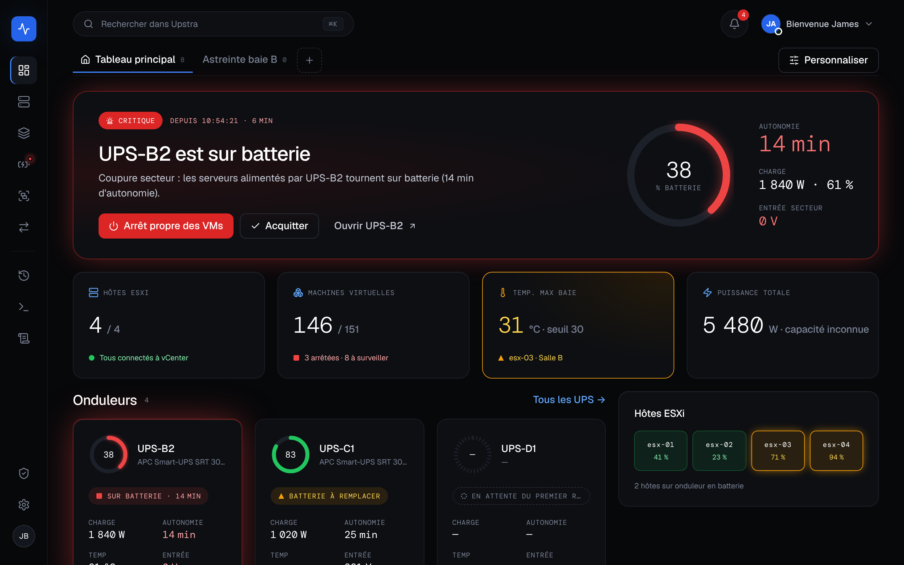
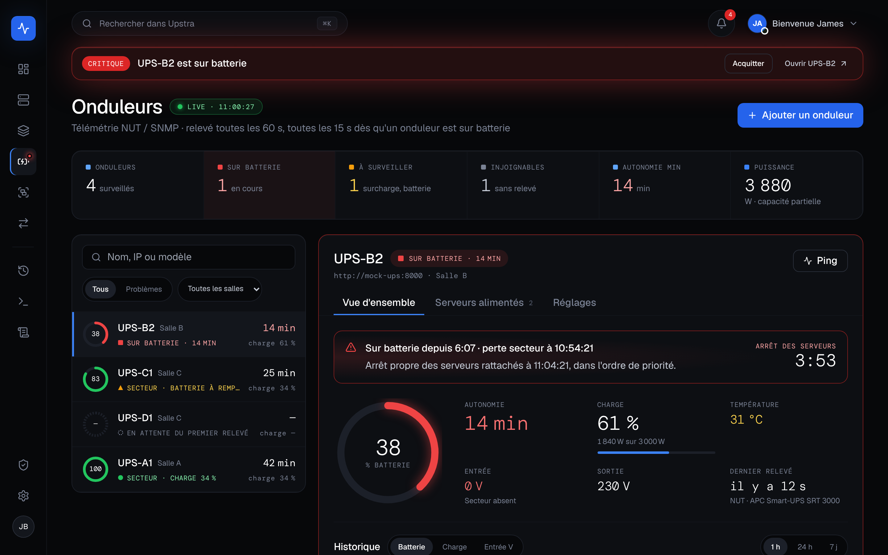
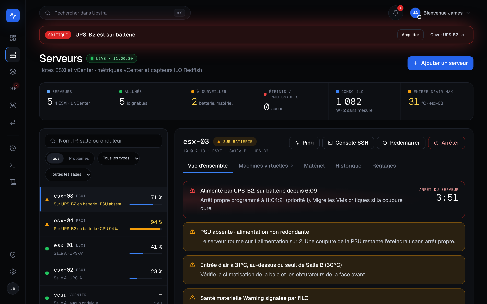
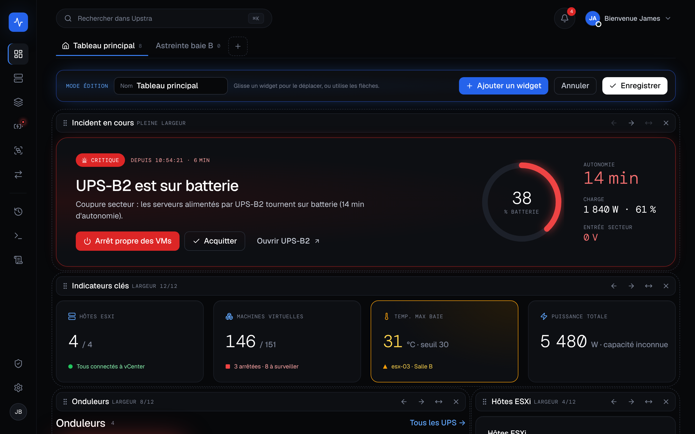
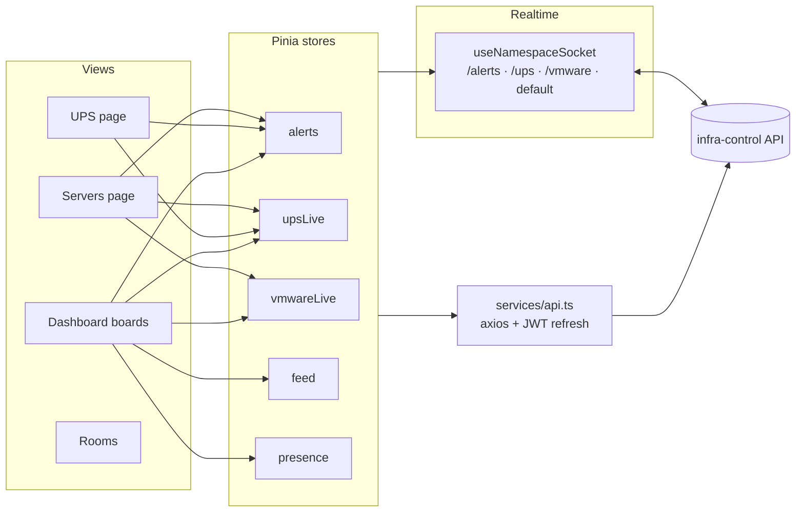

# Infra-Control Front

Infra-Control Front is the web interface for **Upstra**, a platform used to manage servers, rooms, UPS and user roles during power events. It is built with Vue 3, TypeScript and Vite, and follows the **Pulse** design direction: a near-black console where the state of the infrastructure is carried by light.

## ✨ Features

- 🚨 Global incident banner, notification bell and `N CRIT` badges, live over Socket.io, with acknowledgement shared across every open tab
- 🧩 Personal dashboards with ordered widgets (incident, KPIs, UPS, VMs, ESXi hosts, event feed, live power, who is online)
- 🔋 UPS page with full telemetry (mains/battery, load, power, temperature), shutdown countdown, history charts and room moves with their servers
- 🖥️ Server page with health reasons, iLO power with VM-aware confirmation, SSH console, VM actions and hardware readings
- 🌡️ Room environment (max air inlet, total draw, sensor coverage) and per-room inlet thresholds
- 👥 Presence: who is online and which page they are on
- 🌗 Dark first, light theme available, every animation can be turned off (and follows `prefers-reduced-motion`)

## 📸 Preview

| UPS | Servers |
|---|---|
|  |  |

Screenshots are taken with simulated data (UPS-B2 on battery, esx-03 with a missing PSU and a hot air inlet).

## 🏗️ Architecture

- **Features** – each domain lives under `src/features/<domain>/` with `api.ts`, `types.ts`, pure business rules in `domain/`, `composables/`, `components/` and `views/`.
- **Pulse primitives** – `src/shared/components/pulse/` (status pill, metric ring, KPI tile, sparkline, side rail, drawer, callout…), tokens in `src/styles/tokens.css`, design system and briefs in `docs/pulse/`.
- **Values** – every hardware value is nullable and goes through `src/shared/utils/fmt.ts`: a missing reading is shown as `—`, never as `0`.
- **Sockets** – one shared Socket.io connection per namespace, following token refreshes and closed on logout.

## Getting Started

1. Install Node.js 20 and pnpm 10.
2. Run `pnpm install` to install dependencies.
3. Copy `.env-example` to `.env` and adjust values as needed (`VITE_API_URL`, optional `VITE_ENVIRONMENT_LABEL` shown in the rail).
4. Start the development server with `pnpm dev`.
5. Create a production build with `pnpm build`.

## Development

Running `pnpm dev` launches Vite with hot module replacement. A production-ready bundle is generated in the `dist` directory using `pnpm build`. Run the unit tests with `pnpm test`.

## Contributing

We use a Git flow style for collaboration:

- Work is integrated on `flow` (based on `develop`); each brief or fix gets its own `feature/`, `fix/`, `chore/`, `docs/` or `test/` branch merged with `--no-ff`.
- Commit messages follow Conventional Commits, e.g. `feat(ups): add the shutdown countdown`.

Feel free to open issues and merge requests to improve the project.

## 📜 Licence

Infra-Control Front is distributed under the **GNU Affero General Public License v3.0** (`AGPL-3.0-only`), see [`LICENSE`](LICENSE).

In short: you may use, modify and redistribute the code, including commercially, as long as you publish the source code of any modified version under the same licence, **including when it is only offered as a service over the network**.

Copyright (C) 2025-2026 James ABIB, Ronan KIELT, Charles CRETOIS
